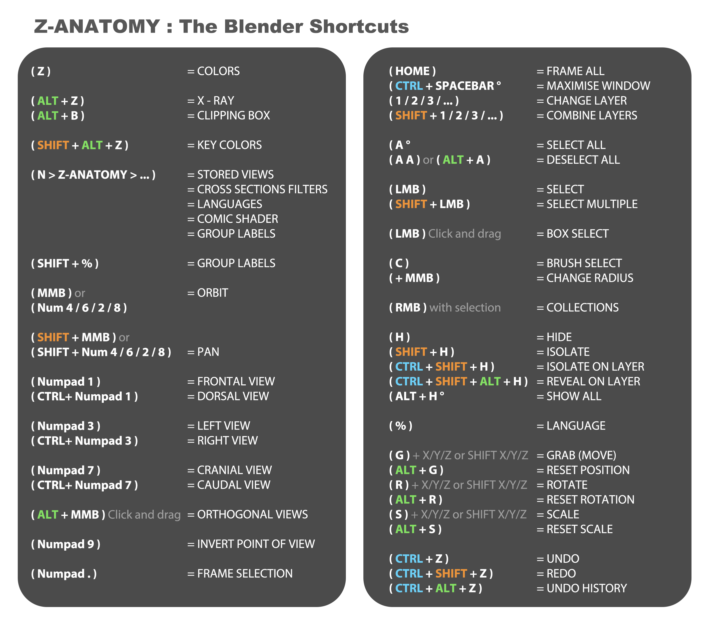

# Z-Anatomy Shortcut & Navigation Cheat Sheet

This document compiles the navigation, visibility, selection, and labeling shortcuts configured in `Anatomy-shortcuts.py`.

---

## 1. 3D Viewport Navigation

| Action | Shortcut | Description |
| :--- | :--- | :--- |
| **Rotate View** | `Middle Mouse Click + Drag` | Orbit around the 3D anatomical structure |
| **Pan / Move View** | `Shift + Middle Mouse Click + Drag` | Pan across the anatomical model |
| **Zoom View** | `Ctrl + Middle Mouse Click + Drag` or `Scroll Wheel` | Zoom in and out |
| **Frame Selected** | `Numpad .` or `Slash (/)` | Focus camera view directly onto selected organ/bone |
| **Local Isolation View** | `Numpad /` or `/` | Isolate selected anatomical structure and hide everything else |
| **Cursor 3D Placement** | `Shift + Right Mouse Click` | Place 3D cursor at anatomical coordinates |

---

## 2. Anatomical Visibility & Layer Controls

| Action | Shortcut | Description |
| :--- | :--- | :--- |
| **Hide Selected Part** | `H` | Hide selected organ/bone from viewport |
| **Unhide / Show All** | `Alt + H` | Restore visibility of all hidden structures |
| **Isolate Hierarchy** | `Down Arrow` | Select active structure and all associated children |
| **Cross-Section Slice** | Cross-section panel / custom operators | Clip planes dynamically across anatomical axes |

---

## 3. Anatomical Labels & Multilingual Features

| Action | Shortcut | Description |
| :--- | :--- | :--- |
| **Create 3D Label** | `Ctrl + Shift + 5` | Generate an anatomical 3D text label pinned to structure |
| **Delta Transform Label**| `Ctrl + Shift + Alt + 5` | Adjust leader line and label displacement |
| **Edit Label Name** | `F2` | Rename or update anatomical label |
| **Fetch Wikipedia Info** | `Ctrl + Shift + 0` | Pull live medical encyclopedia summary via API |
| **Color Coding** | `Shift + Alt + Z` | Apply system-specific muscle/vascular highlight colors |

---

## 4. Blender Application Template Setup

To use the custom keymap within Blender:
1. Copy or install the `Z-Anatomy` folder as an Application Template (`File > New > Z-Anatomy`).
2. Alternatively, in Blender: `Edit > Preferences > Keymap > Import`, and select `Anatomy-shortcuts.py`.
